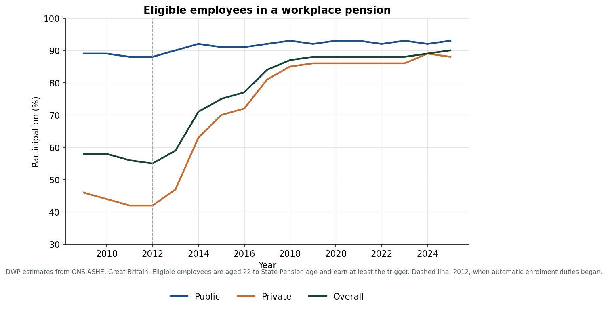
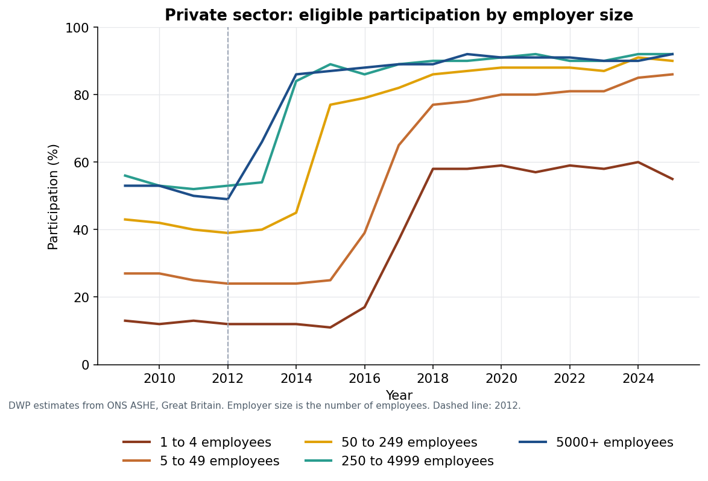
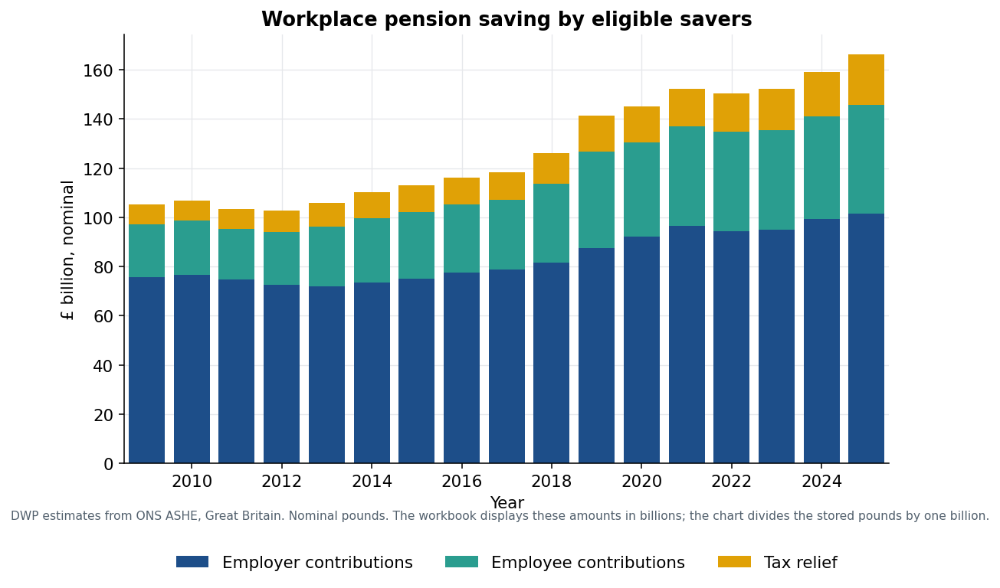
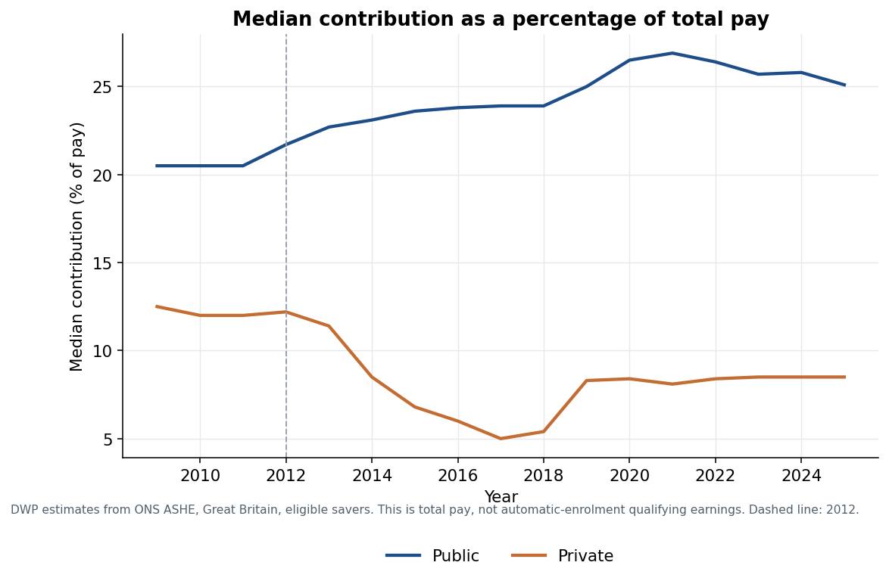
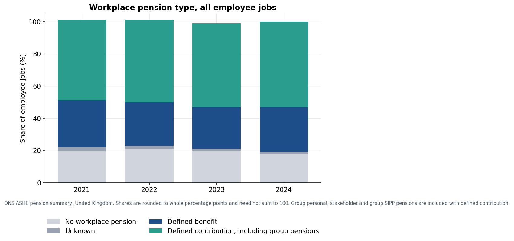
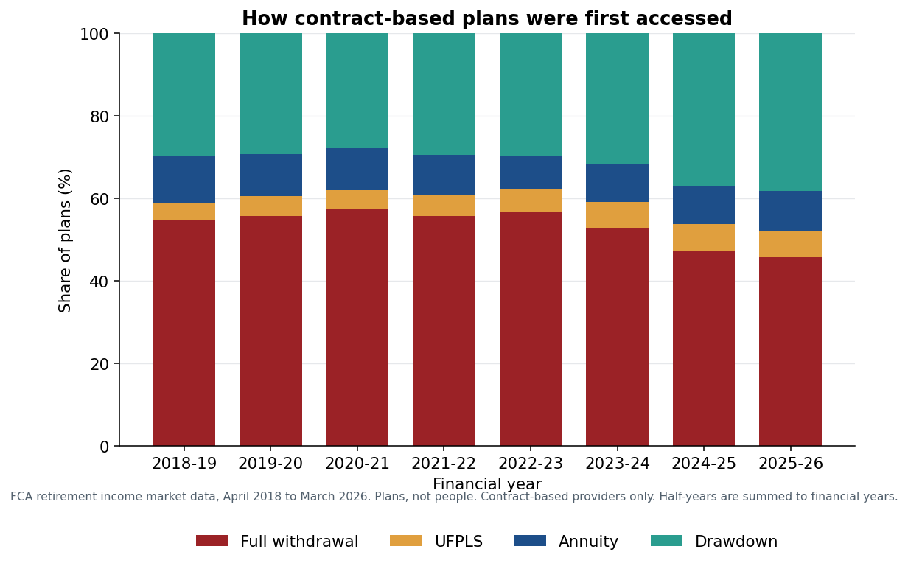

# UK workplace pensions: participation, saving and access

Author: Matthew Allmark

An end-to-end SQL analysis of public UK pensions statistics. The question running through it is what happened to workplace saving after automatic enrolment, and what people do with contract-based pots when they first take money out. Every figure below is taken from the query outputs in `outputs/csv`. Nothing in the database is synthetic.

## Business questions

1. How did eligible participation move, by sector, after automatic-enrolment duties began in 2012?
2. Which ages, employer sizes, industries, regions and hours bands are still behind?
3. Did the amount saved rise with participation, or did the typical private-sector contribution fall because many new savers joined at lower rates?
4. Are people opting out at enrolment, or stopping saving later?
5. How has the mix of defined benefit and defined contribution jobs changed, and how different are employer contribution rates for women and men?
6. When contract-based plans are first accessed, how do annuities, drawdown, UFPLS and full withdrawal compare, in plan counts and in pounds?
7. Where do independent publications agree, and where must they be kept apart?

## Key findings

Eligible participation in Great Britain was already high in the public sector and rose sharply in the private sector once automatic enrolment was under way. In 2012, 42% of eligible private-sector employees were participating (5,896,000 people), against 88% in the public sector. By 2025 those rates were 88% (16,240,000) and 93% (6,371,000). Overall eligible participation went from 55% to 90%, a rise of 35 percentage points, and the number of eligible participants from 10,704,000 to 22,610,000.



The private-sector rise was not uniform. Eligible employees aged 22 to 25 went from 18% in 2012 to 84% in 2025. In 2025 the lowest private-sector eligible age band was still 22 to 25 (84%) and the highest was 46 to 50 (91%). Employers with 1 to 4 employees went from 12% to 55%. Employers with 5 to 49 employees went from 24% to 86%, and those with 5,000 or more from 49% to 92%.



Among private-sector industries in 2025 with a published sample of at least 500 responses, accommodation and food service activities was lowest, at 78% (678,000 participating employees; the DWP label is spelt "Accomodation"). Agriculture, forestry and fishing was 80%, and administrative and support services 82%. Electricity, gas, steam and air conditioning supply was highest at 97%, with financial and insurance activities at 96%. For regions, the East and London were joint lowest among eligible employees at 87%. Scotland and Wales were joint highest at 93%.

Eligible participation in 2025 was 90% for women and 89% for men. That near-parity is not the whole gender picture. On the ONS measure of all employee jobs, private-sector participation in 2024 was 76% for women and 81% for men, and the median employer contribution was 5% of qualifying earnings for women and 6% for men. In the public sector both were 90%, with median employer contributions of 26% and 27%. Part-time eligible employees in the private sector participated at 79%, against 91% for full-time employees. Eligible private-sector employees earning £10,000 to under £20,000 participated at 74%, against 95% for those earning £70,000 or more.

The stock of saving rose, but the private-sector median did not. Eligible savers' total saving was £166.1 billion in 2025: £101.6 billion from employers (61.2%), £44.2 billion from employees (26.6%) and £20.3 billion in tax relief (12.2%). That is £7,346 per participating eligible employee. The private-sector total was £92.1 billion, or £5,671 per participant. The public-sector total was £74.0 billion, or £11,615 per participant.



The median private-sector eligible saver contributed 12.5% of total pay in 2009 (£5,970) and 12.2% in 2012 (£5,890). The median then fell to 5.0% in 2017 (£1,820) as participation widened, and recovered to 8.5% by 2025 (£3,430). The public-sector median was 21.7% in 2012 (£8,790) and 25.1% in 2025 (£9,730). These percentages are of total pay. They are not the automatic-enrolment minimum, which is calculated on qualifying earnings, so they should not be read as above or below the legal minimum.



Opt-out, measured by HMRC Real Time Information, has drifted up. The mean quarterly opt-out rate for all automatic-enrolment eligible active members was 5.3% in 2014-15 and 9.7% in 2024-25. The three quarters published for 2025-26 average 11.9%, so that year is not yet a full-year figure. In 2024-25 the highest age-band opt-out rate was 60 to State Pension age, at 11.63%, followed by 22 to 29 at 10.25%. Ages 40 to 49 were 8.6%. Stopping saving later stayed near 0.8% in 2024-25.

Of UK employee jobs in 2024, 53% were in a defined contribution arrangement (occupational DC plus group personal, stakeholder and group SIPP pensions), 28% were defined benefit, 18% had no workplace pension and 1% were unknown. Among jobs that already had a workplace pension, the defined contribution family was 65% and defined benefit 34%.



DWP's all-employee participation rate for Great Britain and the ONS share of UK employee jobs with a workplace pension match to the percentage point where the series overlap: both 80% in 2021, both 79% in 2022, 79% against 80% in 2023, and both 82% in 2024. The geography and the people-versus-jobs unit still differ. The match is a sense check, not an identity.

On first access of contract-based plans, full cash withdrawal is still the most common route and drawdown is where the money is. In 2025-26, 1,047,008 plans were accessed for the first time, with £91.2 billion of assets. Full withdrawal was 479,485 plans (45.8%) but only £5.8 billion, or £12,059 a plan. Drawdown was 401,137 plans (38.3%) and £70.6 billion, or £176,070 a plan. Annuities were 100,144 plans (9.6%), at £86,190 a plan. UFPLS was 66,242 plans (6.3%). In 2018-19 full withdrawal was 54.8% of plans and drawdown 29.8%. The four methods sum to the published total in every financial year from 2018-19 to 2025-26.



Defined benefit to defined contribution transfers received by FCA-regulated firms fell from 56,990 in 2018-19 to 6,083 in 2025-26. The running total since 2018-19 is 192,631 transfers. In 2025-26, pension commencement lump sums withdrawn across plans came to £22.1 billion. The value of plans fully encashed in the year, a wider FCA measure than first-time full withdrawal, was £7.4 billion.

HMRC Real Time Information, published by DWP, counts 12,940,000 people receiving a private pension payment in 2025-26, up from 11,890,000 in 2015-16. Defined benefit or annuity payments covered 12,200,000 people in 2025-26 (11,780,000 in 2015-16). Lump sums and other defined contribution payments covered 1,820,000 (290,000 in 2015-16). The product rows exceed the count of people by 1,080,000 in 2025-26, because someone can receive both in the same year. Among people paid for the first time, defined contribution lump sums rose from 280,000 in 2016-17 to 410,000 in 2025-26, while defined benefit or annuity first payments were 480,000 and then 430,000.

HMRC's gross Income Tax relief on pensions was £41.7 billion in 2019 to 2020 and £60.4 billion in 2024 to 2025. That is not the £20.3 billion of tax relief in the 2025 DWP eligible-saver total. HMRC's figure covers UK pension tax relief, including relief on the investment income of funds. The DWP figure is the relief component of Great Britain eligible savers' contributions. Query 15 places them side by side and does not treat the difference as an error.

## Data sources

All four publications are reused under the [Open Government Licence v3.0](https://www.nationalarchives.gov.uk/doc/open-government-licence/version/3/). The files are small, so a raw copy is in `data/raw`, with URLs and SHA-256 checksums in `data/raw/manifest.csv`. `pipeline/download.py` fetches them again if a checksum does not match.

| Publication | Publisher | Released | Geography | Used for |
| --- | --- | --- | --- | --- |
| [Workplace pension participation and savings trends: 2009 to 2025](https://www.gov.uk/government/statistics/workplace-pension-participation-and-savings-trends-2009-to-2025) | DWP | 30 July 2026 | Great Britain for the ASHE tables; United Kingdom for the HMRC Real Time Information tables | Participation, amounts saved, opt-out, pension-income recipients |
| [ASHE summary of pension results, 2024 provisional and 2021 to 2023 final](https://www.ons.gov.uk/employmentandlabourmarket/peopleinwork/workplacepensions/datasets/summaryofpensionresultsannualsurveyofhoursandearnings) | ONS | 10 March 2026 | United Kingdom | Defined benefit and defined contribution jobs, employer contribution rates, participation by sex |
| [Retirement income market data 2025/26](https://www.fca.org.uk/data/retirement-income-market-data-2025-26) | FCA | September 2026 | United Kingdom, contract-based providers | First access, transfers, lump sums |
| [Private pension statistics](https://www.gov.uk/government/statistics/personal-and-stakeholder-pensions-statistics) | HMRC | updated 30 July 2026 | United Kingdom | Tax relief, annual allowance, personal pensions, flexible payments |

The DWP workbook stores headcounts and sample sizes with the Excel format `#,##0,`, so the sheet displays thousands while the cell value is the number of people or responses. Saving amounts use `0.0,,,`, so the sheet displays billions while the cell value is pounds. Rates use Excel percentages, so 0.89 is 89%. The loader keeps the stored units and records disclosure markers such as `[x]` and `low` instead of coercing them to numbers. FCA values published in £000 are converted to pounds. HMRC tidy tables are stored in the published £ million.

## How to run

Python 3.11 or later.

```bash
python -m venv .venv
source .venv/bin/activate
pip install -r requirements.txt
make all
```

`make all` downloads anything whose checksum does not match the manifest, rebuilds `data/processed/uk_pensions.sqlite`, runs `sql/`, writes `outputs/csv`, draws `outputs/charts`, and runs the tests. `python run_all.py` does the same. The database is not committed. The CSV extracts and charts are, so the findings can be read without a rebuild.

## Schema

Facts point at `source`. DWP sector labels also point at `sector`. Year, category and pension type are shared as attributes for joins. They are not one coding frame: an HMRC earnings band is not an ASHE earnings band, and an FCA plan is not an HMRC person.

```mermaid
erDiagram
    source ||--o{ dwp_participation : publishes
    source ||--o{ dwp_saving : publishes
    source ||--o{ dwp_median_contribution : publishes
    source ||--o{ dwp_opt_out : publishes
    source ||--o{ dwp_pension_income : publishes
    source ||--o{ ons_pension_type : publishes
    source ||--o{ ons_participation_by_sex : publishes
    source ||--o{ ons_employer_contribution : publishes
    source ||--o{ fca_first_access : publishes
    source ||--o{ fca_flow : publishes
    source ||--o{ hmrc_tax_relief : publishes
    source ||--o{ hmrc_relief_component : publishes
    source ||--o{ hmrc_flexible_payment : publishes
    sector ||--o{ dwp_participation : labels
    sector ||--o{ dwp_saving : labels
    sector ||--o{ dwp_median_contribution : labels
```



`schema.sql` holds the table definitions, keys and checks. `load_audit` records the row count loaded from each publication.

## SQL

| File | Question | Techniques |
| --- | --- | --- |
| `sql/01_data_quality_checks.sql` | Do the parts add up, and where are the disclosure markers? | Aggregation, `CASE`, reconciliation tolerances |
| `sql/02_eligible_participation_by_sector.sql` | Participation since 2012 | `LAG`, windowed baseline |
| `sql/03_private_sector_participation_by_age.sql` | Age bands in the private sector | `RANK`, `LAG` |
| `sql/04_participation_by_industry_region_occupation.sql` | Where participation is lowest in 2025 | `UNION`, quality `CASE`, `RANK` on the usable sample |
| `sql/05_gaps_by_gender_earnings_size_and_hours.sql` | Gaps by gender, pay, size and hours | Conditional aggregation, `FIRST_VALUE` |
| `sql/06_amounts_saved_and_per_participant.sql` | Pounds saved, and pounds per participant | Join of two facts, share of total, year-on-year change |
| `sql/07_median_contributions.sql` | The median after coverage widened | `LAG`, phase `CASE` |
| `sql/08_opt_out_and_stopping_saving.sql` | Opt-out against later cessation | Quarterly average, `LAG`, `RANK` |
| `sql/09_ons_db_and_dc_membership.sql` | Defined benefit against defined contribution | `CASE` into a scheme family, `UNION` of grains |
| `sql/10_ons_contributions_and_participation_by_sex.sql` | Contribution and participation gaps by sex | Join, conditional aggregation |
| `sql/11_fca_retirement_access.sql` | First-access mix and pounds per plan | Half-year roll-up, running total of a flow, `RANK` |
| `sql/12_fca_transfers_and_lump_sums.sql` | Transfers and cash taken out | Running total, year-on-year change |
| `sql/13_private_pension_income_recipients.sql` | Pension-income recipients, and the double count | Join, overlap |
| `sql/14_hmrc_tax_relief_and_allowances.sql` | Tax relief slices and the annual allowance | One slice at a time, running excess |
| `sql/15_cross_source_comparisons.sql` | Where sources can and cannot be compared | Join on year, explicit coverage labels |

Headcount is a stock, so the participation queries do not take a running sum of it. Plan counts and transfers are flows, so those queries do.

## Data-quality checks

`sql/01_data_quality_checks.sql` is also what `pytest` runs. On this build:

- Public plus private eligible and all-employee headcounts match the Overall column to within 1,000 people. DWP rounds each cell to the nearest thousand.
- Male plus female eligible headcounts match the sector total to the same tolerance.
- Employee contributions, employer contributions and tax relief match the published saving total to within £100 million. The tolerance used in the test is £200 million, because each component is rounded to the nearest £100 million before publication.
- ONS pension-type percentages sum to within 1 point of 100. They are published as whole points.
- Annuity, drawdown, UFPLS and full-withdrawal plan counts equal the FCA total in every loaded financial year. The gap is 0.
- 261 participation-rate cells are disclosure markers, almost all `[x]` for an unweighted sample below 20, rather than rates. They are excluded from the rankings.
- There are no duplicate natural keys, and no observed rate outside 0 to 100.

A separate sentinel in `pipeline/validate.py` fails the build if a percentage has been stored as a fraction, or if pounds have been stored as thousands or billions. Those are the easy mistakes with these workbooks.

## Layout

```text
schema.sql                 table definitions
pipeline/download.py       fetch and checksum the source files
pipeline/load.py           clean workbooks and load SQLite
pipeline/run_sql.py        run sql/ and write outputs/csv
pipeline/charts.py         charts
pipeline/validate.py       reconciliation and unit checks
sql/                       numbered, commented queries
data/raw/                  published files and manifest.csv
outputs/csv/               query results
outputs/charts/            charts used above
tests/test_validation.py   pytest wrapper and checksum test
```

## Limitations and next steps

These are published aggregates, not member-level data. ASHE estimates are survey-based, rounded, and suppressed when the sample is small. Industry and region rankings for 2025 drop cells with fewer than 500 responses or with no published sample. Occupation is ranked for 2025 only: DWP note 13 records breaks between SOC 2000, SOC 2010 and SOC 2020. Earnings bands are DWP's bands in 2024 earnings terms, and they are not the bands used in the opt-out table.

Saving is nominal. No price index is joined. The median percentage of pay is not the automatic-enrolment test on qualifying earnings. DWP participation is Great Britain. ONS jobs and HMRC and FCA figures are United Kingdom. FCA counts are plans, not people, cover contract-based providers only, and start in April 2018 because earlier returns were a sample of firms. Trust-based schemes are outside that collection. Someone with two products is counted twice in the pension-income product split; the overlap is reported rather than removed. The 2025-26 opt-out average uses the three published quarters.

HMRC relief and DWP contribution tax relief answer different questions and are not subtracted. The Pensions Regulator's DC and DB landscape statistics, which describe schemes and assets rather than employees, are the obvious next source. A price deflator would separate the rise in nominal saving from prices. A qualifying-earnings bridge would show whether the private-sector median sits near the legal minimum or only looks that way because the denominator differs.

## Licence

Code and documentation: MIT Licence, copyright Matthew Allmark. See `LICENSE`.

The statistics remain Crown copyright and FCA copyright, reused under the Open Government Licence v3.0. Contains public sector information licensed under the Open Government Licence v3.0. Contains Financial Conduct Authority data licensed under the Open Government Licence v3.0.
